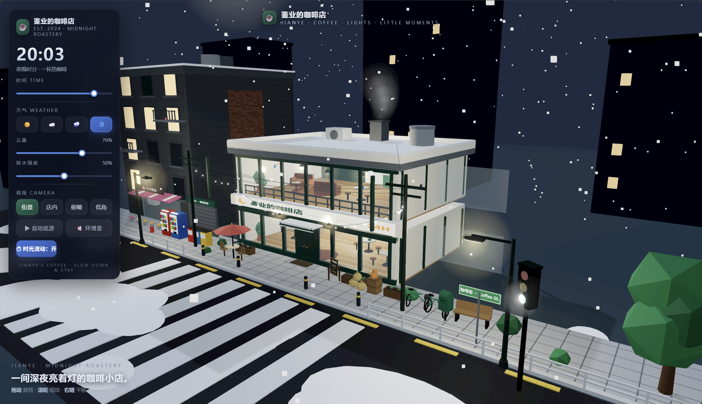

项目在线地址：[https://jianye.pages.dev/coffee-shop-3d](https://jianye.pages.dev/coffee-shop-3d)

一间深夜亮着灯的咖啡小店，不用下载客户端，打开浏览器，就可以沉浸式漫步这个虚拟街角世界。

✨项目简介

这是一个基于 Three.js（WebGL） 纯前端实现的交互式3D网页场景，全部模型程序化生成，没有导入外部GLB模型文件，依靠基础几何体、画布动态贴图、材质光照，搭建出完整的街道与咖啡店环境。

打开链接之后，你可以拖动鼠标旋转视角、滚轮缩放画面、右键平移，自由穿梭街景、店内、俯瞰、低角度多种机位，体验一间24小时营业的街角咖啡店从清晨、正午、黄昏再到深夜的完整昼夜变化。

整个场景不依赖游戏引擎，只需要普通浏览器就可以直接运行，打开网页即可进入这个慢节奏的虚拟小世界。

☕场景里面都有什么？

场景分为两层咖啡店主体，附带隔壁花店、远处城市楼宇、完整街道环境，细节拉满：

咖啡店室内：咖啡机、磨豆机、蛋糕展示柜、货架咖啡豆包、桌椅沙发、落地灯、挂画黑板菜单、盆栽绿植，二层休闲沙发阅读区，吊灯灯带随昼夜自动开关。

外部街道环境：人行道、柏油马路、斑马线、街边路灯、行道树、自行车、自动驶过的小汽车、交通信号灯、自动贩卖机、邮筒、消防栓、街边户外咖啡桌椅。旁边还有一家小花店，远处成片城市楼房，点点万家灯火。

可爱小彩蛋：街角蜷着的小猫、屋顶烟囱袅袅烟雾、街道装饰串灯。

🎛核心交互功能

左侧悬浮控制面板，可以实时调节整个世界的状态：

时间控制系统 拖动时间滑块可以自由跳转一天24小时；开启「时光流动」，世界会自动流逝时间。 天空颜色、月亮太阳位置、星星、建筑灯光会跟随时间实时变化。深夜时分，店铺所有灯光缓缓点亮，星空浮现；清晨太阳升起，灯火慢慢熄灭。

四种天气模拟 晴天☀️ / 多云☁️ / 下雨🌧️ / 下雪❄️

下雨：雨滴粒子、路面积水反光、环境雨声；

下雪：漫天飘雪，地面、屋顶自动堆积积雪；

同时支持手动调节云量、降水强度。还可以打开环境音效，聆听风雨白噪音。

多视角一键切换

街景：站在马路对面远眺整栋咖啡店建筑；

店内：直接进入房屋内部，浏览咖啡店内陈设；

俯瞰：高空上帝视角，俯瞰整条街道；

低角：贴近地面感受街道氛围。

自动巡游：开启之后相机会自动环绕整个场景漫游，适合当做动态背景欣赏。

🛠技术实现要点

渲染库：Three.js r128，WebGL渲染，OrbitControls实现相机拖拽交互

后期效果：Bloom泛光辉光、FXAA抗锯齿、Gamma校正，夜晚灯光柔和发光效果

资源特点：全部模型程序生成，Box、Cylinder、Sphere等基础几何体；Canvas2D绘制动态纹理（地板、砖墙、招牌、菜单、月亮纹理），无外部贴图文件，减少网络资源请求。

动态系统：昼夜光照插值计算、天空颜色渐变、日月星辰位置运算、粒子系统实现雨雪、汽车行驶逻辑、红绿灯状态循环、灯光亮度随环境动态变化。

音频：Web Audio API生成风雨环境白噪音，不需要外部音频文件。

UI：原生CSS实现磨砂玻璃控制面板，做了移动端适配，手机上也可以访问体验。

💡创作想法

我一直很喜欢城市街角咖啡店的氛围感：黄昏路灯亮起，玻璃窗透出温暖黄光，外面行人和车流缓缓流动。于是想着把这份氛围感搬到浏览器中。

没有使用现成三维模型，选择全部代码搭建，既是对Three.js的综合练习，也希望做出一个“慢下来”的小场景。你可以拨动时间，看晴天的午后阳光洒满街道，也可以切换下雪，看着小店在落雪夜晚灯火通明，配上环境音，当作放松的数字小角落。

**JIANYE'S COFFEE · SLOW DOWN & STAY**

打开链接，来这间虚拟小店，歇一会儿。