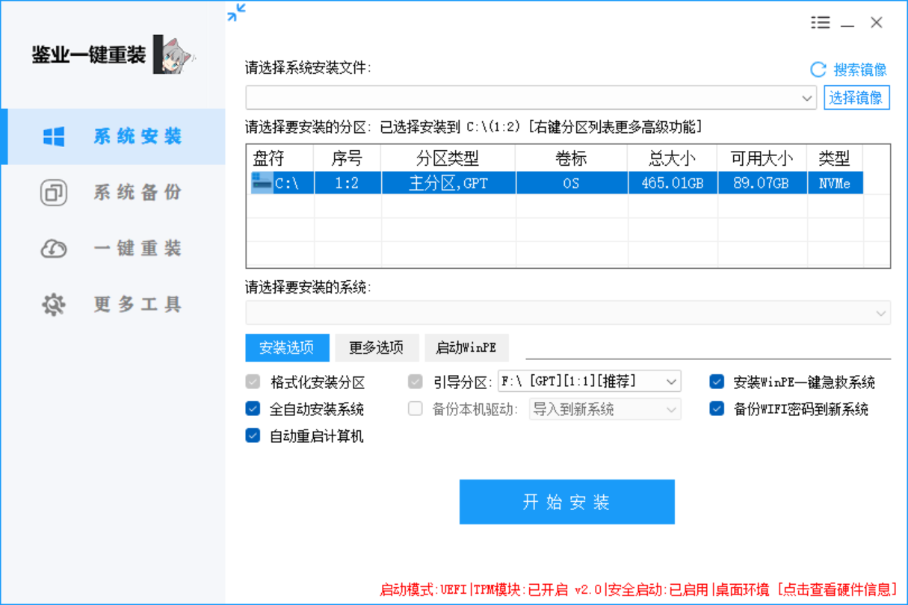
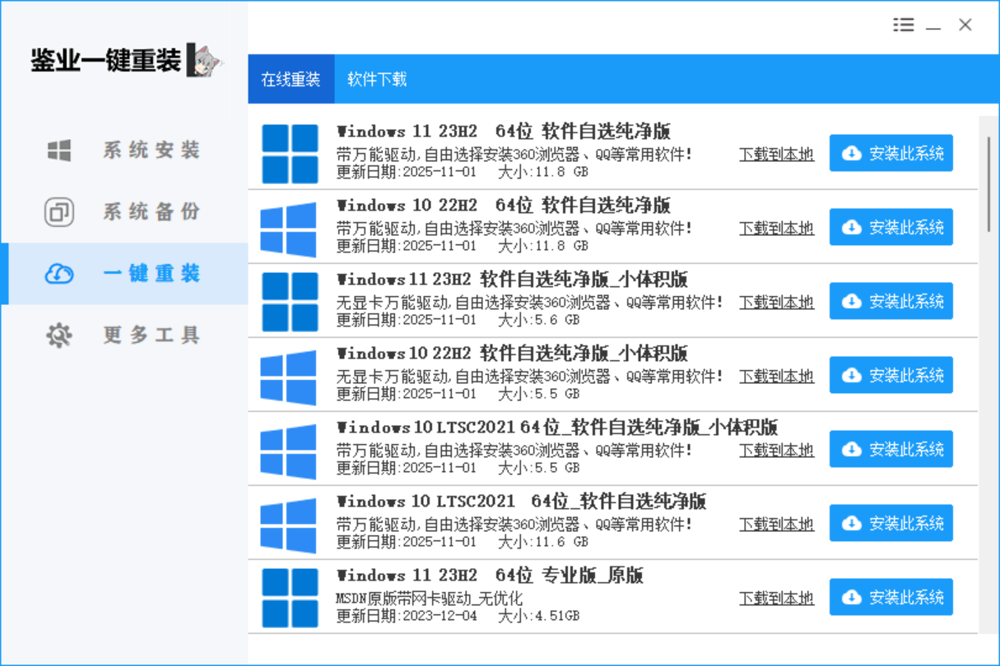
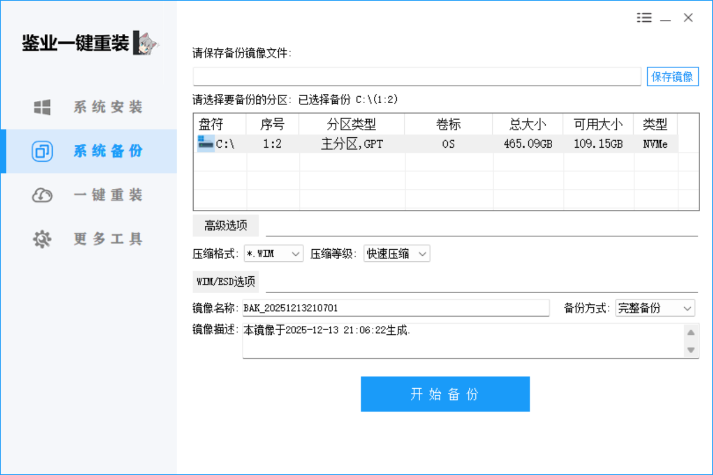
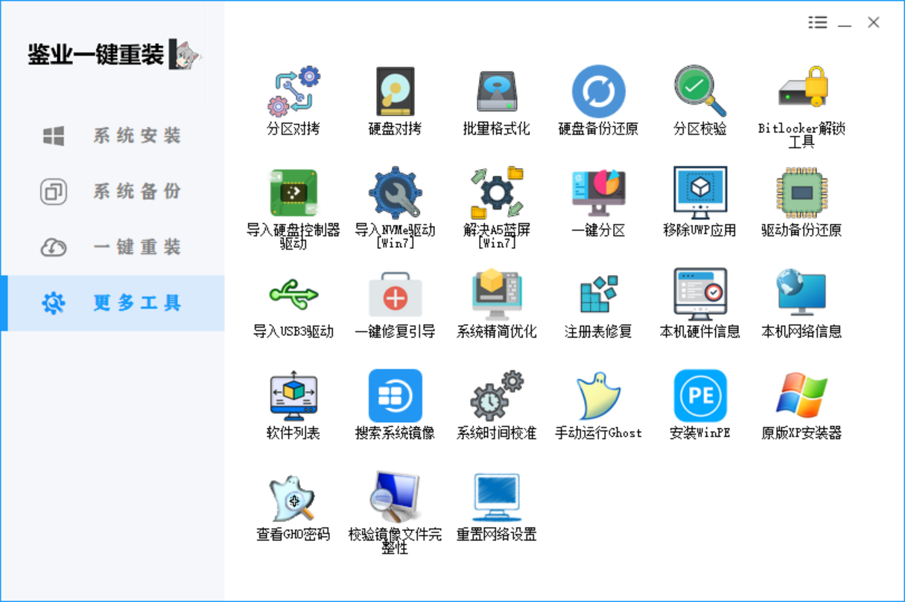

你是不是也遇到过这些电脑难题：系统越用越卡，开机要等 5 分钟；误装软件导致弹窗广告关不完；想重装系统，却被 “BIOS 设置”“分区格式” 这些术语劝退……
今天给大家挖来一款 **「鉴业一键重装」**—— 把系统重装、备份、维护全做成 “傻瓜操作”，哪怕是电脑小白，也能轻松搞定系统问题！
一、它到底有多 “省心”？看完这 4 个核心功能就懂了
1️⃣ 「系统安装」：本地 / 在线双模式，新手也能零失误

打开工具的 “系统安装” 界面，你会发现它把复杂步骤全简化了：
本地镜像安装
：提前下载好的系统镜像（比如 WIM 格式），直接选路径、选 C 盘分区，勾选 “格式化安装分区 + 全自动安装”，点 “开始安装” 就不用管了 —— 它会自动处理引导、驱动，甚至装完自动重启。
细节拉满
：支持 NVMe 固态、GPT 分区（适配新电脑），还能一键装 WinPE 急救系统，哪怕重装中出问题，也能通过 WinPE 救回数据。
2️⃣ 「一键重装」：在线选系统，连软件都能自选

如果没有本地镜像，直接点 “一键重装” 的 “在线重装” 标签：
这里提供 Windows 10/11 的多种版本：纯净版、小体积版、原版，甚至标注了 “带万能驱动”“软件自选”—— 选好系统后，能直接勾选浏览器、QQ 等常用软件，装系统 + 装软件一步完成，不用再挨个下载。

还附带 “系统工具下载”：激活工具、版本切换、性能优化等小工具，解决重装后的后续需求。
3️⃣ 「系统备份」：把当前系统 “存起来”，出问题直接还原

怕重装后数据丢失？“系统备份” 功能帮你提前留后路：
选择 C 盘分区，设置镜像格式（默认 WIM）、压缩等级，点 “开始备份” 就能把当前系统做成镜像文件。
后续系统崩了、中病毒了，直接用这个镜像 “一键还原”，不用再重新装系统、装软件，省时又省心。
4️⃣ 「更多工具」：系统维护的 “万能工具箱”

除了重装和备份，它还藏了一堆实用工具：
急救类
：一键修复引导、解决 蓝屏、安装 WinPE，系统出问题不用慌；
硬件类
：分区对比、硬盘备份、驱动备份还原，帮你管理电脑存储和硬件；
优化类
：系统精简、注册表修复、网络重置，让重装后的系统更流畅。
二、为什么说它是 “小白福音”？
普通用户重装系统的痛点，它几乎都解决了：
不用懂专业知识
：不用进 BIOS 改启动项、不用手动分区，工具自动识别硬件和引导模式；

兼容性强
：支持新电脑的 UEFI 启动、TPM 模块，也能适配旧电脑的传统 BIOS；

风险低
：自带急救系统和备份功能，哪怕操作错了，也能通过镜像 / WinPE 救回电脑。

小提醒：重装前记得做这 2 件事
① 备份 C 盘里的文档、桌面文件（工具会格式化 C 盘）；② 在线重装时，优先选择 “原版” 系统，稳定性更强～

如果你也被系统问题折腾过，不妨试试这款工具 —— 把 “技术活” 变成 “点几下鼠标”，让电脑回归丝滑状态。

[👇 戳这里获取宝藏软件 👇](https://jianye.pages.dev/os/)