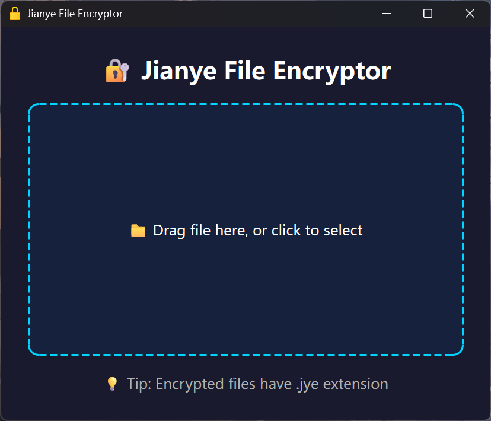

在数字时代，个人照片、私密文档、工作涉密资料随时面临泄露风险。很多普通用户想要保护文件，却对复杂密码学望而却步，命令行加密工具门槛太高，商业加密软件又臃肿繁杂。**Jianye File Encryptor（鉴业文件加密器）**，一款面向普通用户的本地文件加密解密工具，把军用级加密算法封装成简单易用的图形界面，无需专业知识，拖拽文件即可完成加密，为个人与小型团队提供轻量化的文件隐私保护方案。

## 一、工具简介：AES‑256加持，简单优先
鉴业文件加密器是基于 **AES‑256‑CBC** 对称加密算法开发的Windows平台GUI加密软件，使用PyQt6搭建图形交互界面。加密完成后会生成专属后缀`.jye`加密文件，只有输入正确密码，才可以恢复原始文件。

软件贯彻“简单、安全、易用”的设计理念，把密码学底层细节全部封装，普通用户不需要理解加密原理，只需要设置密码，就能完成文件保护。
> ⚠️重要提醒：该工具**没有密码找回功能**，一旦遗忘密码，加密后的`.jye`文件将彻底无法打开，务必妥善保管密码。

### 核心亮点特性
1. **拖拽式GUI交互**：支持直接拖拽文件到窗口，也可以点击选择文件，加密解密进度可视化展示，等待过程一目了然；
2. **系统主题自动适配**：跟随Windows系统自动切换浅色、深色模式，视觉体验舒适；
3. **完整异常容错**：覆盖密码错误、权限不足、文件损坏、程序中途关闭等各类异常场景；
4. **内置原文件名存储**：加密文件头部嵌入原始文件名，解密时自动还原，不需要用户手动修改名字；
5. **大文件友好**：采用64KB分块读写加密，处理GB级大文件也不会过度占用内存。

## 二、核心功能：不止加密解密
除最核心的文件加密、解密之外，软件还配套多项实用辅助能力，兼顾安全与易用性。

|功能模块|能力说明|
| ---- | ---- |
|文件加密|输入密码将普通文件加密为`.jye`文件，加密成功删除源文件，生成临时文件规避异常丢数据|
|文件解密|读取`.jye`文件，输入密码恢复原始文件，解密完成移除加密文件|
|原文件名提取|不解密文件，仅读取文件头，就可以查看被加密的原始文件名|
|加密文件校验|双重校验扩展名与文件头部格式，识别是否为合法的.jye加密文件|
|辅助防护|文件覆盖确认、目录权限预检、窗口关闭安全终止任务、自动清理临时tmp文件、记忆窗口位置大小|

整体软件分为两大代码模块：`crypto_utils.py`负责加密解密底层密码学逻辑；`main.py`负责图形界面、线程调度、进度反馈。加密解密全部放到独立工作线程运行，不会造成Windows界面卡死卡顿。

## 三、安全底层：遵循密码学最佳实践
很多自制加密工具存在随机数不安全、迭代次数过低等漏洞，鉴业加密器在底层设计上规避了大量常见坑点。

1. **加密算法 AES‑256‑CBC**：256位密钥强度，是行业公认高安全等级对称加密标准；
2. **密钥推导 PBKDF2‑HMAC‑SHA256**：使用100000次迭代，搭配`os.urandom()`系统真随机生成16字节盐值、16字节IV初始化向量。即使两份文件使用同一个密码加密，产出密文也完全不同，极大提升暴力破解的成本；
3. **PKCS7标准填充**：采用行业标准填充方案，规避填充Oracle类安全漏洞；
4. **内存安全**：密码仅短暂保存在内存，不会写入磁盘、注册表，使用完毕及时释放；
5. **异常安全回滚**：加密解密中途报错、程序关闭，自动清理`.tmp`临时文件，不会留下损坏的半成品文件；解密失败会自动删除不完整输出文件，避免磁盘垃圾文件残留。

### 加密流程简要梳理
1. 用户选定文件，输入加密密码；
2. 程序生成随机盐值、随机IV；
3. PBKDF2把用户密码结合盐值推导得到32字节AES密钥；
4. 将盐、IV、原始文件名写入`.jye`文件头部；
5. 原文件分块读取，AES‑CBC加密写入临时`.tmp`；
6. 加密全部完成后删除原文件，把临时文件重命名为`.jye`加密文件。

解密时反向执行：读取文件头部拿到盐与IV，再用用户输入密码推导出密钥，对密文分块解密。密码错误会捕获PKCS7去填充异常，提示密码错误，不会直接崩溃。

## 四、上手使用：两步即可保护你的文件
### 文件加密
1. 打开软件，把需要保护的文件拖拽进窗口，或者点击窗口选择文件；
2. 输入加密密码，确认；如果目标`.jye`文件已存在，会弹窗询问是否覆盖；
3. 观察进度条等待完成；完成后源文件被移除，得到`.jye`后缀加密文件。

### 文件解密
1. 将`.jye`加密文件拖入软件；
2. 输入设置的密码；若输出位置存在同名文件，确认是否覆盖；
3. 等待进度走完，软件删除加密文件，还原出最初的原始文件。

> 小提示：最新版本支持直接双击`.jye`文件唤起程序，进一步简化操作。软件会记住上一次窗口大小与位置，每次打开无需反复调整窗口。

## 五、适合哪些使用场景
1. **个人隐私保护**：照片、日记、私人文档加密存放，电脑借给他人使用时，不用担心隐私被翻看；
2. **办公敏感资料**：合同、方案、内部材料加密存储，传输拷贝前加密，防止泄露；
3. **跨设备传输文件**：U盘拷贝、网络发送前加密，就算传输途中文件被截获，没有密码也无法读取内容；
4. **临时数据防护**：电脑临时存放敏感资料，用完解密，闲置状态保持加密状态。

从性能测试来看，普通家用电脑下：10MB小文件加密解密耗时约1秒；1GB大文件也仅十余秒完成，内存占用维持在几十MB，对电脑配置要求很低，普通家用笔记本完全可以流畅运行。

## 六、客观看待：工具边界与注意事项
1. **只支持单文件加密**，尚不支持直接加密整个文件夹，可以先把文件夹打包压缩，再对压缩包加密；
2. **本地离线加密**，所有运算全部本机完成，文件不会上传任何云端；但密码完全由用户保管，软件没有任何找回密码手段；
3. 加密后的`.jye`文件只能使用本软件解密，如果软件丢失，同时密码遗忘，数据永久丢失；
4. 建议重要文件，加密前做好备份，防止意外情况。

## 写在最后
Jianye File Encryptor鉴业文件加密器最大的价值，是把专业密码学能力下沉给普通使用者。很多人想要保护文件，但不愿学习复杂的密码学知识，这款软件正好填补这个空白：底层严格遵循密码学规范，上层交互尽量做到极简。如果你有本地文件加密需求，追求离线、轻量、不联网的加密方案，它值得一试。

**[官方网站](https://jianye.pages.dev/jye/)**