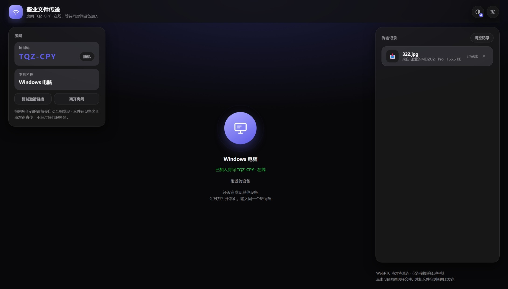

> 项目地址：https://jianye.pages.dev/drop

平时在电脑、手机之间互相传递文件，总会遇到各种各样的痛点：社交软件有严格的文件大小上限，大文件上传下载速度慢；网盘需要注册登录，还要经历上传再下载两道流程；各类传输工具需要安装客户端，不同系统之间兼容性差；还有不少在线传输服务，文件会经过第三方服务商的服务器，存在隐私泄露的隐患。

我开发了**鉴业文件传送**，一款部署在网站上的网页点对点文件传输工具。基于 WebRTC 技术实现设备直连，**文件内容不会经过服务端中转**，只要打开浏览器访问我的网站网址就能直接使用，不用下载任何软件，不用注册账号，局域网、外网环境都可以完成文件互传。

## ✨ 核心功能亮点
### 🔒 点对点直连，保障文件隐私安全
鉴业文件传送依靠 WebRTC 技术建立设备之间的数据通道。
> 仅有设备握手配对的少量信令信息会经过中继，**你的图片、文档、视频、压缩包等全部文件数据，直接在发送设备和接收设备之间流转，不会上传存储到网站后端服务器**。

两台设备成功建立P2P连接后，文件只在两端设备传输，不用担心文件内容被第三方获取，很好地保护你的资料隐私。

### 📱 全平台浏览器可用，零客户端
不需要下载App、不用安装软件，任意现代浏览器访问网站地址即可使用：
- 电脑端：Windows、Mac、Linux，支持 Chrome、Edge、Firefox、Safari
- 移动端：安卓手机、iPhone、iPad，使用系统自带浏览器或者第三方浏览器均可访问

家里、办公室不同系统的设备，只要能打开网页，就能互相发送接收文件。

### 🎫 房间码快速配对设备
采用房间码机制完成多设备配对，操作简单易懂：
1. 打开网站，页面自动生成专属房间码（格式示例 `ABC‑123`）；
2. 其他设备访问同一网站，输入一模一样的房间码；
3. 设备自动互相发现，完成连接，即可开始传文件。

网站还支持生成邀请链接与二维码：复制邀请链接发送给其他人，对方点击链接就会自动填入房间码，无需手动输入；鼠标悬停按钮即可调出二维码，扫码直接加入房间。

单个房间最高支持8台设备同时在线，房间内所有设备两两之间都可以互相发送文件。

### 📤 流畅的文件传输体验
提供两种发送文件的操作方式：
1. 点击页面上的设备头像圆圈，唤起文件选择弹窗，挑选需要发送的文件；
2. 直接将本地文件拖拽到目标设备头像上，立刻启动传输。

支持批量多文件发送，大文件自动分片处理，内置**断点续传能力**。遇到网络波动、连接意外断开，重新建立连接之后，可以从已经接收完成的位置继续传输，数百兆的大文件不需要全部重新发送。

传输过程实时展示进度百分比、实时传输速度、预估剩余时间；所有传输记录保存在浏览器本地，刷新网页记录不会消失。收到文件一键点击保存到本机，还可以开启提示音，收到新文件自动播放提示音效。

### 🎨 丰富的界面自定义能力
- **显示主题**：跟随系统自动切换、浅色模式、深色深色三种模式可选；
- **个性化配色**：提供8套主题色彩，修改网页界面与设备头像颜色；
- **多语言**：内置19种全球常用语言，包含简体中文、繁体中文、英文、日语、韩语、法语、德语、阿拉伯语等，会自动识别浏览器系统语言；
- **多语言排版适配**：完美支持阿拉伯语等从右向左书写的语言；
- **移动端适配**：手机访问网站自动切换为竖屏单列布局，触摸操作友好。

## 🛠️ 技术简单介绍
整套程序部署在网站服务器上，访问网址即可加载全部页面资源。
1. **信令协商**：使用 PeerJS 完成设备之间的握手协商，自动切换多CDN源，网络差的时候会自动重试；
2. **WebRTC DataChannel**：使用数据通道完成二进制文件分片传输，不占用音视频通道；
3. **前端离线二维码生成**：二维码全部由浏览器本地运算生成，不调用外部在线二维码接口；
4. **浏览器本地存储**：房间码、自定义设备名称、主题配色、传输历史全部保存在浏览器本地，服务器不会保存你的个人配置；
5. **心跳在线检测**：自动识别设备在线状态，手机切后台、网页被系统冻结休眠，能够自动识别设备退出房间；
6. **自定义传输协议**：实现分片发送、断点续传、取消传输、失败重试整套完整的文件交互逻辑。

> 小提示：部分复杂外网NAT网络环境，P2P直连无法建立时，仅握手信令走中继，文件数据依旧不会经过服务器。

## 📖 使用教程
1. 在你的设备浏览器打开我的网站访问鉴业文件传送页面；
2. 点击「随机」按钮生成全新房间码，也可以手动自定义输入房间码，设置本机显示的设备名称；
3. 另一台设备打开相同网站，填写同一个房间码；
4. 页面识别出在线的其他设备；
5. 点击对方设备头像选择文件，或者直接拖拽文件到头像上发送；
6. 接收方在传输记录栏，点击保存，将文件下载保存到自己设备。

> 小技巧：复制页面的邀请链接发给好友，或者扫描二维码，对方打开链接就自动加入房间，省去手动输入房间码。

## 📝 适合这些使用场景
1. 电脑和手机互传视频、压缩包等大文件，不想受社交软件大小限制；
2. 内网局域网环境传输文件，希望文件不走公网服务器，注重隐私；
3. 跨系统设备互传：Windows ↔ iPhone，安卓 ↔ Mac；
4. 临时给身边同事、朋友发送文件，不想登录各类网盘账号；
5. 断网局域网环境，多台设备之间批量传递资料。

## ⚠️ 使用注意事项
1. 网页版基于浏览器WebRTC，**传输过程网页标签页必须保持打开，关闭网页会中断传输**；
2. 部分企业内网、严格防火墙会拦截WebRTC连接，会导致设备无法建立P2P通道；
3. 传输历史记录存储在浏览器本地，清除浏览器缓存数据会清空记录；
4. 单房间最多容纳8台设备，满员后需要部分设备退出，新设备才可以进入房间。

## 🎯 写在最后
市面上很多文件传输服务，要么强制把文件上传到服务商服务器，要么要求下载臃肿客户端。鉴业文件传送追求轻量化，**只需要访问网址就可以使用，文件数据尽可能做到点对点直传，你的文件数据只留在你自己的设备上**。

如果你经常需要在多台设备之间来回搬运文件，把网站链接收藏到浏览器书签，随时随地打开网页，就可以完成设备之间的文件互传。