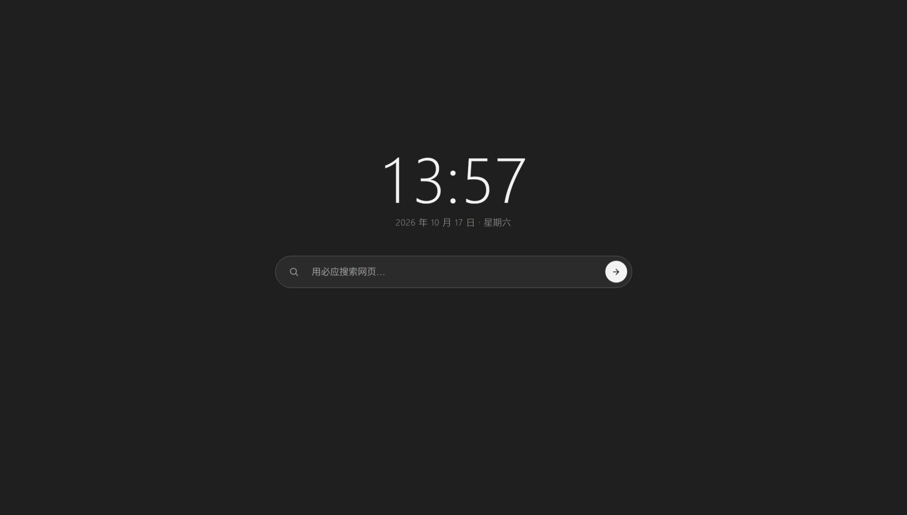

> 项目地址：[https://jianye.pages.dev/homepage-sharepage](https://jianye.pages.dev/homepage-sharepage)

每次打开浏览器新建标签页，你会看到什么？满屏推送新闻、弹窗广告、五花八门的内容推荐。很多起始页不断堆砌功能，把新标签页变成信息流广场，我们本只想快速搜索，却被各种信息裹挟，注意力被不断切碎。

于是我动手做了 **Jianye's Homepage**，一个简约、干净、高效的浏览器新标签页，回归浏览器起始页本该有的样子：纯粹，高效，无打扰。

## 🧩 设计理念：做减法，而不是做加法
市面上很多主页产品热衷于增加功能、组件、资讯流。而这个主页的核心思路是**剔除冗余，保留刚需**。

- ❌ 没有弹窗、没有多余推荐、没有花哨广告
- ✅ 克制干净的布局，去掉一切会分散注意力的元素
- ✅ 完全免费使用，没有会员付费、没有隐性广告

打开新标签，页面不会强行塞给你任何内容，把选择权交还给使用者。

## ⚡ 核心特性
### 极简设计，零干扰
整个页面视觉克制留白，没有花里胡哨动画与装饰。当你打开浏览器，视线不会被杂乱元素抢夺，专注于你真正要完成的搜索与浏览任务。

### 极速加载，秒开体验
摒弃臃肿资源，不加载大量图片与脚本。无论网络好坏，标签页瞬间打开，不会出现转圈等待渲染的情况。低配设备也能流畅运行。

### 中心搜索框，开箱即用
搜索框直接置于页面中央，打开标签自动聚焦光标。输入关键词即可直接搜索，省去多层跳转，一步直达检索，把搜索这件事回归简单。

### 简单实用，回归搜索本质
保留时间显示等基础实用要素，砍掉华而不实的组件。不堆砌小工具、不堆砌资讯流，回到浏览器主页最原始的定位：上网的入口，而不是内容消费地。

## 🚀 如何体验
两种方式可以使用：
1. **网页版直接体验**：打开链接即可直接使用，无需安装。
2. **下载安装**：可以下载作为浏览器新标签页扩展，接管浏览器新建标签。

> 访问地址：[https://jianye.pages.dev/homepage-sharepage](https://jianye.pages.dev/homepage-sharepage)

## 💡写在最后
现在互联网产品总习惯不断给用户“投喂”信息，打开任何页面都在想方设法争夺你的注意力。
我希望这个主页提供一处小小的数字净土。当你点开新标签，不再被广告、热点推送裹挟，只是安安静静地开始你的上网。

**如果你厌倦杂乱的浏览器起始页，不妨试一试。欢迎体验，也欢迎分享给同样喜欢极简上网体验的朋友。**