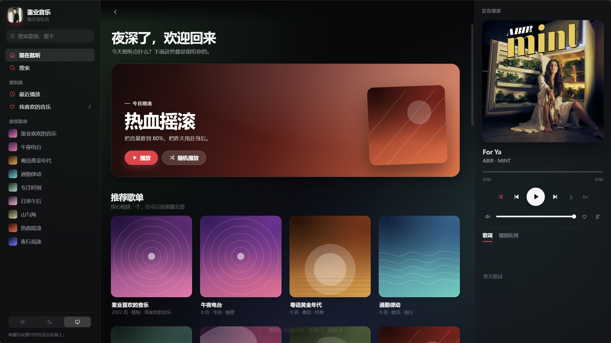

> 项目地址：[https://jianye.pages.dev/music](https://jianye.pages.dev/music)

一直想拥有一个完全属于自己的听歌页面，不受客户端广告、开屏弹窗打扰，于是花时间手写了**鉴业音乐**，一个复刻 Apple Music 设计语言的纯前端网页音乐播放器，打开浏览器即可直接使用，无需下载任何软件。

## ✨设计：借鉴 Apple Music 的极简美学
界面参考 Apple Music 的设计风格，大量使用**大圆角、毛玻璃磨砂质感、柔和渐变、舒适留白**。
- 完整支持**深色 / 浅色 / 跟随系统**三套主题，手机、平板、电脑都能自动适配；
- 环境光动态背景：会根据正在播放歌曲自动渲染柔和的渐变光晕；
- 响应式布局：电脑端三栏布局，平板自动收起右侧播放面板，手机自动切换侧边抽屉 + 底部迷你播放条。

## 🎵核心功能一览
### 📚歌单与曲库
内置多套按心情分类的精选歌单：午夜电台、粤语黄金年代、通勤律动、专注钢琴、日系OST、民谣、热血摇滚、夜行电子。
- 支持**酷狗我喜欢音乐同步**，把自己酷狗收藏的歌曲自动拉到网页端播放，海量收藏也可以流畅加载；
- 支持搜索，输入歌名、歌手即可检索曲目；
- 每个歌单内部自带搜索过滤，几千首歌也可以快速定位想要听的歌曲。

### ▶播放能力
- 基础播放控制：顺序、随机、单曲循环；上一首、下一首、进度拖拽调节；
- **播放倍速**：0.5×‑2.0×可调，同时附带定时关闭（15/30/60分钟）；
- 完整歌词支持，包含翻译歌词，全屏播放页可滚动高亮当前行歌词；
- 播放队列管理，可以把歌曲加入队列、设置为下一首播放、删除队列曲目；
- 媒体会话适配：电脑、手机系统通知栏可以直接控制播放暂停切歌；
- 支持单首歌曲下载，浏览器直接保存音频文件。

### ❤个人资料库（全部保存在浏览器本地）
> 所有收藏、播放记录**只保存在你的浏览器本地 localStorage，不上传任何服务器**，隐私优先。
1. **我喜欢的音乐**：收藏喜爱歌曲，支持导出JSON备份、导入备份文件，换浏览器也可以迁移收藏列表；
2. **最近播放**：自动记录听过的歌曲，最多保存24条播放历史；
3. 歌单收藏：可以收藏页面内置的推荐歌单；
4. 播放状态记忆：刷新网页、关闭标签重新打开，会自动恢复上次播放进度、播放队列。

### ⌨快捷键支持
不用鼠标也能操作播放器：
- 空格：播放 / 暂停
- 左右方向键：快进5秒、回退5秒
- 上下方向键：调节音量
- N/P：下一首 / 上一首
- `/` 快速跳转到搜索页
- ESC：关闭全屏播放、关闭弹窗菜单

## 🛠技术实现
整个页面为单页面 HTML+CSS+原生JavaScript，**没有使用任何框架（Vue/React）**，全部手写，部署在 Pages 静态托管上。
1. CSS 变量实现完整多主题，`backdrop‑filter` 实现磨砂玻璃UI；
2. 原生Audio作为播放器内核，MediaSession对接系统媒体控制；
3. localStorage存储全部用户收藏、播放状态，数据留在本地；
4. 对接音乐解析接口完成歌曲搜索、获取音源、封面图、歌词；
5. 针对大歌单做渲染性能优化，队列只渲染可视附近片段，防止几千首歌造成页面卡顿。

## 📱使用小提示
1. 直接打开链接即可使用，**不需要注册登录**；
2. 收藏、播放记录仅保存在当前浏览器，清除浏览器数据会丢失，记得导出喜欢音乐做备份；
3. 酷狗同步功能，仅部署在线环境可用，本地直接打开html文件无法调用云端同步接口；
4. 推荐使用 Chrome、Edge、Firefox现代浏览器，老旧浏览器部分磨砂效果会降级。

## 💡写在最后
做鉴业音乐，初衷就是摆脱臃肿的客户端，只想安安静静听歌。
没有开屏、没有推送、没有繁杂的社区，回归音乐本身。你可以打开网页，点开歌单，把浏览器最小化，就单纯享受音乐。

如果你感兴趣，可以直接访问：👉 [https://jianye.pages.dev/music](https://jianye.pages.dev/music)